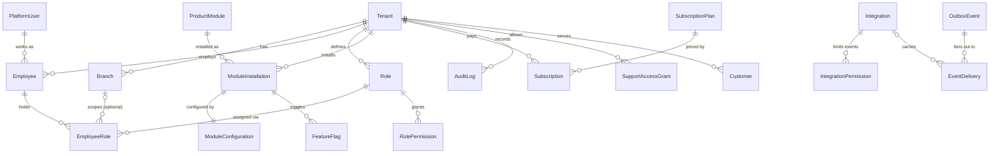

# Xeva Restaurant OS — Database & Core Platform Blueprint (Phase 0)

Engineering deliverable 1 from the master specification. It describes what is implemented
in this repository today. Section numbers in brackets refer to the master spec.

## 1. What Phase 0 delivers

| Area | Status | Where |
| --- | --- | --- |
| Monorepo (pnpm + Turborepo) | Done | `package.json`, `turbo.json` |
| PostgreSQL + Prisma migrations | Done | `backend/api/prisma/` |
| Tenant & branch management | Done | `src/core/tenants/` |
| Authentication (email + password, JWT) | Done, interim | `src/core/identity/` |
| Employees, roles, permissions (RBAC, branch-scoped) | Done | `tenant.guard.ts`, `@xeva/contracts/permissions` |
| Module registry, lifecycle, feature flags | Done | `src/module-registry/` |
| Event infrastructure (outbox, dispatcher, retries, DLQ, replay) | Done | `src/integration-engine/` |
| Integration Centre API | Done | `integrations.controller.ts` |
| Immutable audit log | Done | `src/core/audit/`, RLS migration |
| Xeva support access (time-limited, audited) | Done | `tenants.controller.ts` |
| Permission-aware navigation | Done | `GET /me/navigation` |
| Shared UI library | Done (minimal) | `packages/ui` |
| Restaurant Admin portal (Deliverable 2) | Done: overview, modules + feature flags, Integration Centre, team, branches, settings/branding, billing, audit | `apps/restaurant-admin` |
| Xeva Super Admin portal (Deliverable 2) | Done: overview, onboarding, restaurant detail (plan, status, support access), catalogue, plans, integration monitoring, audit | `apps/xeva-super-admin` |
| Team, subscription and platform APIs | Done | `src/core/employees`, `src/core/platform` |
| M01 Digital Token (Deliverable 3) | Done: queues, walk-in + remote tokens, priority, call/recall/skip, ETA, TV display, tracking, daily report, `token.*` events. Gated by `@ForModule` + feature flags | `src/modules/digital-token`, `apps/customer-pwa` |
| CI/CD (GitHub Actions) | **Not started** | Phase 0 remainder |
| Customer OTP login, OIDC provider, MFA | **Not started** | Phase 1–2 |
| Redis / BullMQ | **Deferred** | The outbox is polled from Postgres for now |

## 2. Entity-relationship diagram



Platform-level tables (no tenant): `tenants`, `platform_users`, `permissions`, `product_modules`,
`subscription_plans`. Every other table carries `tenantId` and is protected by Row Level Security.

Conventions [5.3]: UUID primary keys, foreign keys, `createdAt`/`updatedAt`, soft delete (`deletedAt`)
where history matters, explicit status enums, money stored as integer paise.

## 3. Tenant isolation [5.2]

Isolation is enforced twice, so a bug in one layer is caught by the other.

**Application layer — `TenantGuard`**
1. The client *selects* a tenant (`:tenantId` in the route or the `X-Xeva-Tenant` header).
2. The guard checks that the signed-in user is an ACTIVE employee of that tenant, or a Xeva admin
   with a live `SupportAccessGrant`. Otherwise it returns `403 TENANT_ACCESS_DENIED`. The response
   is the same whether or not the tenant exists.
3. An optional `X-Xeva-Branch` must belong to the tenant, and the employee must hold a role that covers it.
4. Permissions are calculated from tenant-wide roles plus the roles for the selected branch.

**Database layer — PostgreSQL RLS** (`prisma/migrations/*_rls_policies`)
- The API connects as `xeva_app`, which has no superuser rights and no `BYPASSRLS`. Migrations run as `xeva_owner`.
- Every query runs in a transaction that sets `app.tenant_id` (`PrismaService.withTenant`).
  Policies allow only rows with `"tenantId" = app.tenant_id`, for both reads and writes.
- With no context set, tenant tables return nothing (fail closed).
- `app.system = 'on'` is reserved for internal workers: the outbox dispatcher and audited admin operations.

## 4. Module registry and activation [6]

- The catalogue lives in `packages/contracts/src/modules.ts`. It holds all 17 modules with their
  features, published and consumed events, and permissions. It is seeded into `product_modules`.
- Activation checks that the module is available, that the tenant's subscription plan includes it
  (`402 MODULE_NOT_IN_PLAN`) and that any dependencies are active.
- The lifecycle follows `MODULE_TRANSITIONS`. Deactivating a module never deletes its configuration
  or flags, so reactivating it restores them.
- Feature flags are stored separately from activation: `PATCH /tenants/:id/modules/:moduleId { features }`.

## 5. Integration engine [7]

```
business change + OutboxEvent ──(same transaction)──▶ outbox_events (PENDING)
          dispatcher fan-out ──▶ event_deliveries (one row per eligible consumer)
          dispatcher delivery ──▶ consumer.handle(envelope)
                 success → SUCCEEDED · failure → FAILED, retried with backoff (base·2^n)
                 after N attempts → DEAD_LETTER → replay from the API
```

- **Eligibility:** a module consumer receives an event only if it is ACTIVE for that tenant **and**
  an ACTIVE integration connects the event's source module to it **and** any `IntegrationPermission`
  rows allow that event. Core services receive every event they subscribe to.
- **Duplicate protection:** the unique key on `(eventId, consumer)` means re-running fan-out can never
  create a second delivery. Consumers must still be idempotent, because delivery is at-least-once.
- **Concurrency:** rows are claimed with `FOR UPDATE SKIP LOCKED`, so several API instances can
  dispatch at the same time.
- Integrations are re-checked at delivery time, so disconnecting stops the flow immediately.

## 6. API (prefix `/api/v1`)

| Method | Path | Permission |
| --- | --- | --- |
| POST | `/auth/login` | public |
| GET | `/me` | signed in |
| GET | `/me/navigation` | tenant member |
| POST / GET | `/tenants` | Xeva admin |
| POST | `/tenants/:tenantId/support-access` | Xeva admin |
| GET / PATCH | `/tenants/:tenantId` | `tenant.view` / `tenant.manage` |
| GET / POST | `/tenants/:tenantId/branches` | `branches.view` / `branches.manage` |
| GET | `/modules` | signed in |
| GET / POST | `/tenants/:tenantId/modules` | `modules.view` / `modules.manage` |
| PATCH | `/tenants/:tenantId/modules/:moduleId` | `modules.manage` |
| GET / POST | `/integrations` | `integrations.view` / `integrations.configure` |
| PATCH | `/integrations/:id` | `integrations.configure` |
| POST | `/integrations/:id/test` · `/enable` · `/disable` | view / configure |
| GET | `/integrations/:id/events` | `integrations.view` |
| GET | `/integration-events?status=` | `integrations.view` |
| POST | `/integration-events/:deliveryId/replay` | `integrations.configure` |
| GET | `/audit-logs` | `audit.view` |

Errors always use the shape `{ "error": { statusCode, code, message, details?, correlationId } }`.

## 7. Deliberate deviations from the master spec

- **Code layout:** core services, the module registry and the integration engine live inside
  `backend/api/src/` rather than as top-level folders. This keeps the modular monolith one Nest
  build. Shared contracts are in `packages/contracts`.
- **No Redis/BullMQ yet:** the outbox is polled from Postgres. Swap in BullMQ when notifications and
  reports need it.
- **Interim authentication:** email + password with signed JWTs. Replace with an OIDC-compatible
  provider before production.

## 8. Next steps

1. Finish the rest of Phase 0: shared UI package, Restaurant Admin and Super Admin shells, and CI.
2. Deliverable 2: Super Admin + Restaurant Admin screens on top of this API.
3. Deliverable 3: the M01 Digital Token module as the first standalone product, registered as an
   event consumer and producer.
